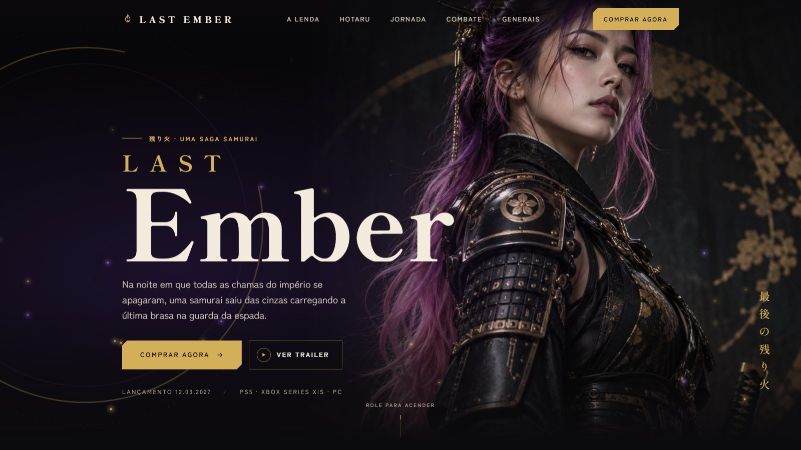

# Last Ember

[](https://last-ember-gilt.vercel.app)

[](https://last-ember-gilt.vercel.app)

Landing page de um jogo que não existe. Last Ember é uma saga samurai que inventei para ter um pretexto de fazer uma página de lançamento no nível das que os grandes estúdios publicam: hero em tela cheia, história contada na rolagem, personagens e pré-venda.

Não precisa baixar nada para ver: o site está publicado em **[last-ember-gilt.vercel.app](https://last-ember-gilt.vercel.app)**.

## O jogo

Na Noite das Cinzas, o Regente Kurogane apaga a chama sagrada que iluminava o império havia mil anos e divide as brasas entre sete generais. Hotaru, a última do clã Murasaki, sai dos escombros com uma fagulha presa na guarda da espada. São cinco províncias até o trono, e a brasa enfraquece a cada uma.

Estúdio, preços, data de lançamento e elenco de dublagem também são inventados.

## A página

A página segue a história de cima para baixo: prólogo, protagonista, jornada, combate, inimigos e edições. As partes que deram mais trabalho:

- A rolagem com inércia foi escrita do zero. Ela usa o tempo real entre os quadros, então a sensação é a mesma num monitor de 60 Hz ou de 144 Hz.
- Na Jornada, um pavio queima conforme você desce e acende cada capítulo quando chega nele.
- Combate e Generais prendem a tela. No combate, a rolagem passa pelas quatro técnicas; nos generais, desliza os sete para o lado. Depois a página segue normalmente.
- O retrato da Hotaru tem pontos que explicam detalhes da armadura e da espada.
- A pré-venda abre num modal com escolha de edição e plataforma. Nenhum pagamento é processado.

Quem usa o sistema com animações reduzidas recebe a página sem movimento, e as seções presas viram abas e uma faixa com rolagem lateral. O mesmo vale para telas com menos de 560 px de altura.

## Stack

HTML, CSS e JavaScript, sem framework, sem dependências e sem build. Os scripts são clássicos, e não ES modules, para a página abrir também direto do disco. Cada comportamento fica num arquivo em `js/modules/` e se registra num namespace global (`LE`); o CSS tem um arquivo por seção.

Personagem, cenários, generais e produtos foram gerados com IA.

## Rodando localmente

Baixe o projeto pelo botão **Code → Download ZIP** aqui no GitHub (ou clone o repositório), extraia a pasta e abra o `index.html` no navegador. Como a página não depende de build nem de servidor, ela funciona assim mesmo, direto do disco.

```bash
git clone https://github.com/RobertoDev3/last-ember.git
```

Se for mexer no código, vale abrir a pasta no VS Code e usar a extensão [Live Server](https://marketplace.visualstudio.com/items?itemName=ritwickdey.LiveServer): ela sobe um servidor local e recarrega a página sempre que você salva um arquivo.

## Estrutura

```
index.html
css/
  main.css        importa o resto
  base/           cores, fontes, reset e animações
  layout/         container, cabeçalho, menu e rodapé
  components/     botões, mídia, brasas, hotspots e modais
  sections/       um arquivo por seção
js/
  core/           namespace LE e a rolagem com inércia
  modules/        um arquivo por comportamento
  main.js
assets/
  images/         uma pasta por seção
  videos/         vazia por enquanto
```

O vídeo de fundo do hero e o trailer ainda não existem. Sem eles, o hero mostra a imagem e o botão de trailer avisa que a estreia é em breve.

## Direitos

© 2026 Roberto. Todos os direitos reservados.

Não é permitido usar este projeto, no todo ou em parte, para fins comerciais. Isso inclui o código, as imagens e os textos.

---

Feito por [Roberto](https://github.com/RobertoDev3).
